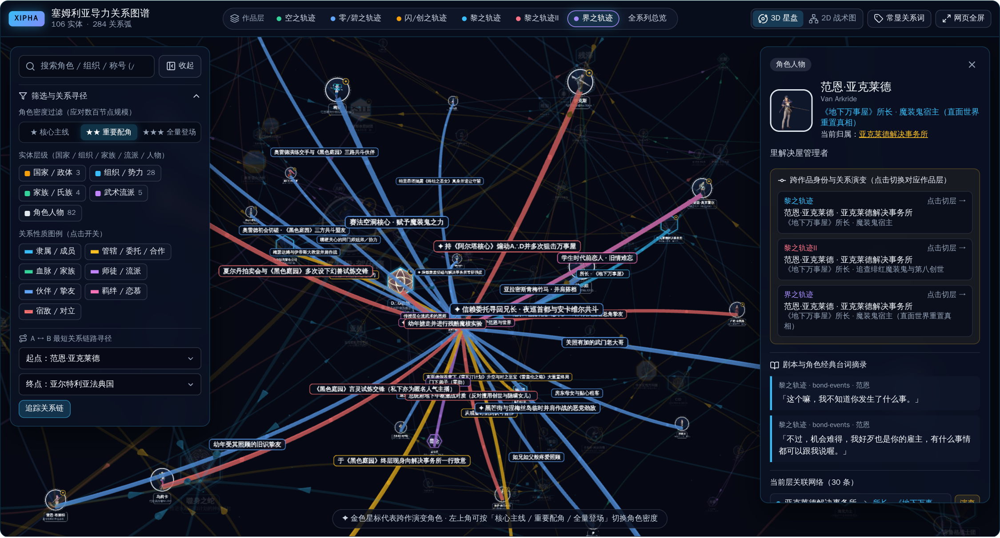

# Kiseki Interactive Relationship Graph

Interactive **3D WebGL & 2D Tactical** multi-arc relationship graph for the *Trails / Kiseki* (*轨迹*) series, packaged both as a **zero-SQL static-JSON WordPress plugin** and a standalone Vite/React web viewer.

**Live Online Demo**: [https://trails-game.com/relations/](https://trails-game.com/relations/)

[](https://trails-game.com/relations/)

## Highlights

- **Complete 6-Arc Zemuria Dataset**: Covers *Trails in the Sky* (`sora`), *Zero / Azure* (`zero_ao`), *Cold Steel / Reverie* (`sen`), *Daybreak* (`kuro`), *Daybreak II* (`kuro2`), and *Beyond the Horizon* (`kai`) — **449 entities** and **1,186 relationships** with `Shift+Click` multi-arc comparison and transitive `supersedesId` relationship evolution.
- **Dual Rendering Engines**:
  - **3D Constellation (`3D 星盘`)**: `3d-force-graph` + Three.js composite portrait/nameplate sprites, regional sector clustering, directional particles, and retina edge-label pills.
  - **2D Tactical Map (`2D 战术图`)**: `d3-force` + convex faction hulls, 3-tier semantic zoom (LOD), collapsible organizations, and 1-hop/2-hop Ego Ring focus.
- **Scale & Mobile Friendly**: 3-tier character prominence filter (`★ 核心主线` / `★★ 重要配角` / `★★★ 全量登场`), collapsible filter dock, shortest-path finder (`A ↔ B`), mobile bottom-sheet inspector, and in-window fullscreen (`网页全屏`).
- **Zero-SQL WordPress Plugin & Visual Studio**: Atomic `flock` static JSON storage (`wp-content/uploads/kiseki-relations/`) with versioned snapshots, rolling backups, `.json`/`.csv`/`.xlsx` import/export, CPT (`dt_team` / `org` / `region`) auto-linking, and full backend parity for **`Editor`** and **`Administrator`** roles.

## WordPress Installation

1. Download **`kiseki-relation-graph.zip`** from the [Releases](../../releases) page.
2. In **WP Admin → Plugins → Add New → Upload Plugin**, upload the zip and click **Activate**.
3. Embed the graph using the **`轨迹人物势力关系图 (Kiseki Graph)`** Gutenberg block or `[kiseki_relation]` shortcode:

```text
[kiseki_relation mode="full" default_arc="kai" default_tier="supporting" default_view="3d" height="84vh"]

[kiseki_relation mode="mini" focus_post_id="current" default_arc="auto" default_view="2d" height="460px" full_url="/relations/"]
```

## Development & Building from Source

```bash
npm ci

# Start standalone Vite dev server (http://localhost:5173)
npm run dev

# Validate dataset, build WordPress assets, and package kiseki-relation-graph.zip
python3 tools/validate_dataset.py
npm run build:wp
python3 tools/package_plugin.py
```

To test inside a local WordPress + MariaDB stack (`http://localhost:8088`, provisioned automatically via `docker/setup-wp.sh`):

```bash
npm run build:wp
docker compose up -d
```

## CI & Releases

- **Pull Requests & `main` (`ci.yml`)**: Runs TypeScript typechecking, PHP syntax linting (`php -l`), 189-subgraph dataset topology validation, and full web + WordPress plugin builds.
- **Releases (`release.yml`)**: Pushing a `v*` tag (e.g. `v1.0.3`) automatically builds and attaches `kiseki-relation-graph.zip`, `kiseki-relation-web-dist.zip`, and `SHA256SUMS.txt` to the GitHub Release.

## License

GPL-2.0-or-later
